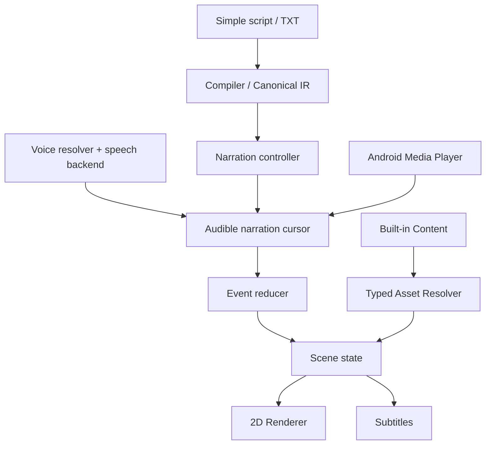

# VisualBook Dependency Graph — Initial Conceptual Map

**Status:** CONCEPTUAL architecture graph, not AST-verified code. [graph.json](graph.json) is the maintained graph. Generate a complete Mermaid view with `python3 knowledge-system/graphify/graphify.py mermaid`.

## Primary constraints

1. A synthesizer can finish preparing audio without changing narrative progress.
2. One canonical IR supports TXT, simple speaker markers and advanced packages.
3. Default asset resolver is typed and has real procedural fallback, not assumed images.
4. UI/renderer are downstream of narrative state and cannot decide story progression.
5. Script model must not depend on Android UI, a graphics engine or selected voice provider.

For task-specific context selection use [ICM](../icm/README.md); for implementation priorities use [Implementation Plan](../../IMPLEMENTATION_PLAN.md).
